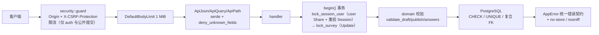

# 防御性编程评审报告（2026-09-28）

> 评审对象：`questionnaire-api`（`backend/`）与 `frontend/`。
> 评审方式：网络检索防御性编程基线 → 7 个只读并行侦察切片（domain / surveys / submissions / reports / auth+admin / frontend / 既有验证记录）→ 对关键路径（登录、锁序、发布、导出、领域数值、前端解析、配置、DDL）逐项复核源码。
> 证据边界：**纯静态分析**。未改动任何代码，未连接真实 PostgreSQL 实跑，未做压测与浏览器闭环；涉及时延/吞吐的判断已在文中标注 `[推断]`。
> 相关既有文档：`docs/backend-review-checkpoint-2026-09-15.md`（09-15 审查存档）、`docs/requirements-analysis.md` §11/§12（验证记录）。本报告区分「既有记录」与「本次新发现」，见 §8。

## 1. 防御性编程评估基线

| 原则 | 要点 | 来源 |
|---|---|---|
| 边界一次性校验 | 不可信输入在最外层转换为类型（parse-don't-validate / newtype + 私有字段 + 智能构造器），下游不再重复校验；Rust 官方立场是**拒绝 Postel 宽容原则**，能静态拒绝就静态拒绝 | Comprehensive Rust、Rust API Guidelines C-VALIDATE |
| 句法 + 语义双层 | 句法（格式/类型/长度）与语义（业务上下文：区间、状态）都要校验；**服务端校验不可省略**，前端只是 UX；白名单优于黑名单；Unicode 文本要规范化 | OWASP Input Validation CS |
| Fail fast / fail loud | 违约立即显式失败；不静默兜底、不吞异常、不用默认值续命；断言只用于「程序员错误」，输入错误走 `Result`/4xx | TCSS 305、ArchMan |
| 不变量承载 | 不变量应由类型、构造器或 DB 约束承载，而不是文档与自觉；状态机用枚举穷尽匹配，避免 stringly-typed | CMU 15-214、RustTraining、nutype |
| Fail closed（安全侧） | 认证/鉴权/CSRF 失败必须拒绝；错误响应不泄漏内部信息，但**失败必须可观测**（错误标识/日志） | OWASP、Defensive programming anti-patterns |
| 反模式 | 冗余防御（到处重复检查）、catch-all 掩盖、静默类型降级、把「不可能发生」当假设、读到脏数据靠猜 | Defensive programming anti-patterns、ArchMan |

核心张力：**「严格收（fail fast）」与「优雅降（graceful degradation）」必须按层选择**——安全决策 fail closed，展示/兼容层可降级，但降级要显式且可诊断。

## 2. 防御架构与请求路径

- 严格三层：HTTP 边界 → 业务用例 → 数据访问；`domain.rs` 是纯函数，无 I/O。
- 锁序唯一：publisher user → survey，集中在 `repository.rs`，所有写路径（含 admin 治理、公开提交）复用。
- 不变量三层兜底：传输层 1 MiB、领域层容量/精度、数据库 `CHECK/UNIQUE/FK`。

## 3. 已落实的防线（证据抽样）

| 层 | 事实 | 位置 |
|---|---|---|
| 边界解析 | 提取器把 body/query/path 一次解析为类型；413 `body_too_large`、400 `invalid_json` 且不回显原始输入 | `backend/src/http.rs:22-61`、`backend/src/lib.rs:135` |
| 严格 DTO | 全部写 DTO `deny_unknown_fields`；`Question::deserialize` 手写以绕开 flatten 与严格模式冲突，拼错字段拒绝而非丢弃 | `backend/src/domain.rs:34,62-94,103`、`backend/src/surveys.rs:89-122` |
| 配置 fail-fast | `DATABASE_URL` 必须 postgres；HTTPS↔`COOKIE_SECURE` 矛盾即拒启；非本机强制 HTTPS；TTL/限流范围校验 | `backend/src/config.rs:30-80` |
| CSRF / 安全头 | 精确 Origin + `X-CSRF-Protection: 1` + 无 CORS；403/429 也经统一出口补 `no-store`/`nosniff` | `backend/src/security.rs:62-95` |
| 认证 | Argon2id + `spawn_blocking`；session 只存 SHA-256 摘要；Cookie `HttpOnly; SameSite=Lax`；登录轮换 token；事务内复核密码版本 | `backend/src/auth.rs:177-210,392-463` |
| 并发不变量 | `lock_session_user` 在持锁后重验请求携带的 Session，封堵「等待锁期间被禁用/改密/退出」 | `backend/src/repository.rs:37-46,70-80` |
| DB 兜底 | 状态/角色/动作 `CHECK`、`unpublished⟺current_version_id IS NULL` 复合约束、`UNIQUE(survey_id,number)`、匿名/登录 scope 一致性 `CHECK`、登录限次部分唯一索引 | `backend/src/schema.sql:11-70` |
| 乐观并发 | 草稿 `revision` 显式 409 `revision_conflict`；列表/版本读用 `RepeatableRead + ReadOnly` 快照 | `backend/src/surveys.rs:759-770,1051-1058`、`backend/src/reports.rs:254-274` |
| 注入面 | 全量绑定参数；CSV 对**所有单元格**（含表头）做公式注入防护，先剥离空白/控制符/BOM/双向控制符再判 `= + - @` | `backend/src/reports.rs:565-572,791-803` |
| 数值精度 | `arbitrary_precision`；裸整数 i64/u64 范围与 2^53 精确性校验；`-0.0` 归一 | `backend/src/domain.rs:519-559`、`backend/Cargo.toml:19` |
| 前端契约 | 写请求带 CSRF 头 + `credentials:'same-origin'` + 30s 超时；会话仅内存；路由 `safeReturn` 封开放重定向；全仓无 `v-html/innerHTML` | `frontend/src/api.ts:36-47`、`frontend/src/router.ts:5-11` |
| panic 面 | 全仓无 `unsafe`、运行期无 `unwrap/expect/panic!`；唯一 `expect` 是编译期常量（时区偏移） | `backend/src/reports.rs:41` |

## 4. 缺口与风险（按严重度）

| # | 风险 | 证据 | 既有记录 |
|---|---|---|---|
| 1 | **登录时序侧信道**：用户名不存在时不做 Argon2 直接返回，存在用户付出完整哈希时间，可远程枚举账号；与同文件「不区分三种失败」注释矛盾 | `backend/src/auth.rs:163-168` | 是（09-15 已复现，未处理） |
| 2 | **管理员自锁**：可禁用自己或最后一个 admin，同事务清空其会话，之后无法登录；`create-admin` 同名返回 409，无法用原名恢复 | `backend/src/admin.rs:121-141`、`backend/src/auth.rs:327-359` | 否（新发现） |
| 3 | **统计/导出无规模上限**：`fetch_all` 全量载入 + 整份 CSV 在内存构造 + 无流式/行数上限 + 报表端点不在限流窗口 | `backend/src/reports.rs:565-580,730-788,437-438`、`backend/src/security.rs:18-21` | 部分（已记「已知规模风险，未处置、无压测」） |
| 4 | **DB 兜底约束触发即 500**：`UNIQUE(survey_id,scope,key_hash)`/登录限次唯一索引冲突未映射语义错误码（应为 `already_submitted`/`idempotency_conflict`），幂等正确性隐含依赖「survey 行锁 + READ COMMITTED」 | `backend/src/submissions.rs:229-239,300-301`、`backend/src/error.rs:101-113` | 否（新发现） |
| 5 | **publish 无幂等、不推进 revision**：响应丢失后重试会插入第二份内容相同的新版本行（`versions` 不可变、只增） | `backend/src/surveys.rs:846-878` | 否（新发现） |
| 6 | **500 不可诊断**：`AppError::internal` 丢弃错误对象，只记固定字符串，无 error id/kind；唯一约束冲突、题面损坏、内部违约在日志中不可区分——「响亮但无声」 | `backend/src/error.rs:60-69` | 否（新发现） |
| 7 | **读取侧不变量缺失**：评分分布 `value as i32` 裸截断（NaN→0）；数值未复查 `is_finite`；统计对脏数据 500 而导出静默留空；同一函数「类型不对 fail loud、ID 不认识 fail silent」 | `backend/src/reports.rs:636-646,675-698,772` | 部分（`type-no-stringly` 已记；读取侧校验为新发现） |
| 8 | **匿名幂等命名空间 + 客户端密钥**：匿名 `scope` 为常量、key 由客户端自由给出（仅校验 v4 形态）；key 复用 + 同载荷会让后来者拿到 200 + 他人 `receipt_id`，而自己的答卷被静默丢弃；可预测 key 可占位造成 409 拒绝 | `backend/src/submissions.rs:216-239,300` | 否（新发现） |
| 9 | **限流维度缺陷**：整实例单计数器、不区分来源，单客户端可耗尽全局配额（拒绝服务其他用户）；admin 与问卷写接口完全不限流；多实例部署每实例一份配额 | `backend/src/security.rs:43-58,97-106`、`backend/src/config.rs:75-79` | 部分（设计已文档化） |
| 10 | **前端「断言当校验」**：唯一解析口 `decode<T>` 末尾 `as T`；Admin 按 tab 断言数组元素；数字边界 `Number()` 无 `isFinite`；`while(true)` 分页无页数上限；错误体解析 `catch {}` 吞掉导致 401 过期事件不发；会话恢复失败后 `initialized` 永久置位不可自愈 | `frontend/src/api.ts:14-24,53-54`、`frontend/src/views/AdminView.vue:25-27`、`frontend/src/components/QuestionEditor.vue:22-26`、`frontend/src/views/ReportsView.vue:38-45`、`frontend/src/stores.ts:13-27` | 否（新发现） |
| 11 | **类型层不设防**：`Document/Question/Answer` 全 `pub`、无 newtype/私有构造/`TryFrom`，「已通过 validate_publish」没有类型承载；`status/mode/role` 为裸 `String`，字面量散布 | `backend/src/domain.rs:33-169`、`backend/src/admin.rs:35`、`backend/src/repository.rs:77-99` | 是（`type-no-stringly`，未处理） |
| 12 | **公开读路径持写锁**：`GET /api/public/surveys/{id}` 走 `lock_public_survey`，对 survey 行取 `FOR UPDATE` 并持有到 commit，题面读取与所有提交互相串行 `[推断：高并发打开填写页会拉长写等待]` | `backend/src/submissions.rs:323-346`、`backend/src/repository.rs:53-59` | 否（新发现） |
| 13 | **上限不一致**：body 1 MiB 小于领域合法最大答卷（100 题 × 5000 字符 CJK ≈ 1.5 MB），合法填写会被 413 | `backend/src/lib.rs:135` vs `backend/src/domain.rs:15-19` | 否（新发现） |
| 14 | **零散静默/弱校验**：`SurveyFilters` 无严格模式（拼错筛选参数静默退化）；`DELETE` 无 revision 前置（stale 客户端可删他窗口新存的草稿）；过期会话无回收（`sessions_expiry` 索引无消费者）；注册 409 是用户名枚举 oracle；无 CSP；admin 路由权限靠每 handler 手写 `require_admin` 而非路由层强制 | `backend/src/surveys.rs:133-140,812-822`、`backend/src/schema.sql:15`、`backend/src/auth.rs:355-359`、`backend/src/admin.rs:20-31` | 部分是（过期会话、枚举面已记） |

## 5. 反向分析：过度防御与 KISS 违反

过度防御的判定标准：**防御成本 > 它挡住的真实风险**；重复真相源；为不可能发生的输入付复杂度；防御机制本身引入新的失败模式。本项目这类问题的代价主要在**「真相份数」与维护成本**，只有 #D、#G 有运行时成本。

| # | 过度防御点 | 位置 | 成本 | 判定 |
|---|---|---|---|---|
| A | 「到期即 closed」四处实现 | `backend/src/surveys.rs:667-685`、`surveys.rs:1071-1080`、`repository.rs:84-95`、`admin.rs:167-181` | 4 份真相，已出现返回类型不一致 | 净负 |
| B | `Pagination` + 自写 Visitor 只为拒绝 `+1` | `backend/src/http.rs:79-101` + `admin.rs:54-57`/`reports.rs:57-62`/`surveys.rs:137-140` 三处 `flatten` | ~23 行机制 + 放宽「严格」原则 | 净负 |
| C | 数字精度「裸整数严检、小数/指数放行」双轨 | `backend/src/domain.rs:519-552` | ~34 行只买到局部保证 | 净负 |
| D | 公开**读**路径取 `FOR UPDATE` 写锁 | `backend/src/submissions.rs:323-346`、`repository.rs:53-59` | GET 与提交串行 `[推断]` | 净负 |
| E | 限流用路径字符串分类 | `backend/src/security.rs:97-106` | 路由表第二份真相，会漂移 | 可简化 |
| F | 前端 lossless-json 全链路保真 | `frontend/src/api.ts:15-24`、`types.ts:4,90,123-137`、`answers.ts:67`、`components/QuestionStats.vue:14-19` | 抽象泄漏已产生真 bug | 净负 |
| G | `sessions_expiry` 索引零消费者 | `backend/src/schema.sql:15` | 纯写放大 + 表无界增长 | 净负 |
| H | 不变量文档四处重复 | `AGENTS.md:136`、`docs/requirements-analysis.md:309`、`docs/backend-review-checkpoint-2026-09-15.md:33` | 已漂移（写 7 个测试，实际 8 个） | 净负 |

### A. 同一条业务规则，四份实现

- 写路径物化：`repository::expire_survey`（`backend/src/repository.rs:84-95`）
- 读派生：`surveys::effective_status`（`backend/src/surveys.rs:1071-1080`）
- 列表 SQL 手工镜像：`backend/src/surveys.rs:667-685`
- admin 视图 inline 再写一遍，且丢弃枚举、返回 `status: String`：`backend/src/admin.rs:167-181`

改这条规则要同时改 4 个地方；`admin` 那份没走 `SurveyStatus`，同一份数据在 owner 视图是枚举、在 admin 视图是裸字符串。KISS 做法：`effective_status()` 一处定义语义，列表过滤复用，admin 复用同一枚举。

### B. 为 `?page=+1` 写了一个 23 行反序列化器

`flatten` 迫使 Serde 缓冲为字符串，于是 `Pagination` 依赖 `optional_u64` 同时接受数字与十进制字符串——这本身是**放宽**（「be strict in what you accept」的反面），只为在 3 个查询 DTO 里复用结构体。它拒绝的 `+1`/`" 1"`，用 6 行 ASCII 数字校验 helper 即可覆盖，代价是删掉 flatten 与 Visitor。

### C. 精度防御买的是「局部」，不是「不变量」

`finite_number` 用 `contains(['.','e','E'])` 分两路：裸整数走 i64/u64 + 2^53 精确性 + 饱和 i128 比较（严谨）；小数/指数只查有限性（宽松）。结果 `1e-400`→`0.0`、`1.0000000000000000001`→`1.0` 会被当成合法整数接受，而 `docs/backend-guide.md` 4.2 已把「按有限 f64 语义处理」写成契约。这套机制既没覆盖全部输入，也没比文档承诺更强。KISS：一条规则（有限 + `|x| ≤ 2^53` / 落题面 `min..max`）替代 34 行特判。

### D. 读接口用排他行锁

`GET /api/public/surveys/{id}` → `read_public_survey` → `lock_public_survey`，对 survey 行取 `LockType::Update` 并 `begin()`/`commit()` 一个可写事务。GET 不写，没有任何东西需要串行。项目在别处（`backend/src/reports.rs:254-274`）已证明会写 `RepeatableRead + ReadOnly`，这里属过度悲观。

### E–H 简述

- **E**：`starts_with("/api/auth/")` / `ends_with("/responses")` 是路由表的副本；新增 auth 路由忘了改这里，限流静默失效且无告警。改 `route_layer` 挂载即可。
- **F**：`ExactNumber` 渗进 DTO、答案回传、渲染三层；代价是 `Number()` 无 `isFinite` 时 `1e999 → Infinity`，经 lossless-json 的 `typeof value === 'number'` 分支回退 `JSON.stringify`（`frontend/node_modules/lossless-json/lib/esm/stringify.js:59-61`）静默变 `null`，用户设的数值上下界无声消失（`frontend/src/components/QuestionEditor.vue:22-26`）。服务端最终把答案归一到 f64 再算幂等哈希，客户端保真的收益基本只剩显示。
- **G**：索引只在 `schema.sql` 出现，没有任何语句按 `expires_at` 读写；会话表又不清理。要么删索引，要么补上唯一消费者。
- **H**：`AGENTS.md:136` 与 `docs/requirements-analysis.md:309` 写「7 个测试」，实际是 8 个（`backend/tests/domain.rs:50,109,154,205,246,307,324,352`）。同一批锁序/校验规则散在四份文档里，漂移只是时间问题。

### 这些不算过度防御（不要顺手删）

- **三层上限分工不同**：body 1 MiB（传输）、`domain.rs` 容量（领域）、DB `CHECK`（持久化）——任一层失效仍有兜底。
- **`lock_session_user` 锁内重验**：由已复现的「迟到请求体」bug 驱动。
- **`deny_unknown_fields`**：`min`→`minimum` 静默丢弃是已复现 bug。
- **CSV 公式注入防护**：真实攻击面、零误报成本。
- **`checked_add`/`checked_mul`**：1 行消除 panic/回绕面。
- **`spawn_blocking` + Argon2id + SHA-256 摘要**：正确性与秘密卫生。

## 6. 优先级清单

### 6.1 补强（按收益排序）

1. `backend/src/auth.rs:167` 前插入 dummy Argon2 verify（固定哈希），对齐两条登录路径耗时。
2. `backend/src/admin.rs:121` 拒绝 `id == actor.id` 的禁用，并要求操作后仍存在至少一个未禁用 admin（DB 侧可加部分唯一索引兜底）。
3. `backend/src/reports.rs` 导出加行数上限（超限 422，建议缩小时间范围）或改流式 `Body`；`security.rs` 把报表端点纳入限流。
4. `backend/src/error.rs:60-69` 引入内部 error id（`tracing` 记录 `error_id` + 错误种类，响应回带 id）；随后把 `submissions.rs:300` 的唯一约束冲突映射为语义 409。
5. `backend/src/surveys.rs:846-878` 发布同事务推进 `revision`（或加发布幂等键），使重放显式 409。
6. `backend/src/reports.rs:636-646,772` 读取侧显式校验（`fract()==0` 且 `is_finite`，失败 `invalid_stored_answer`），统一统计/导出对脏数据口径。
7. 前端：`api.ts:14` 引入最小运行时形状校验；`QuestionEditor.vue:22` 加 `Number.isFinite`；`ReportsView.vue:38` 加分页上限。
8. 长期：`SurveyStatus`/`Mode`/`Role` 改为从 DB 边界解析的枚举；文本/标题包 newtype，把校验移入构造器。

### 6.2 简化（去掉重复真相）

1. 【A】`effective_status()` 成为唯一定义，admin 与列表过滤复用；`admin::SurveyItem.status` 改用 `SurveyStatus`。
2. 【D】`read_public_survey` 改为 `RepeatableRead + ReadOnly` 或普通查询，去掉 `FOR UPDATE` 与写事务。
3. 【G】删除 `sessions_expiry` 索引，或补上按 `expires_at` 的清理语句。
4. 【E】限流改由 `route_layer` 挂到对应 router，删除路径前缀判断。
5. 【B】三个查询 DTO 直接持有 `page/page_size`，用短 helper 做 ASCII 十进制校验，删除 `optional_u64` Visitor 与 `flatten` 依赖。
6. 【C】统一为「有限 + 2^53 安全整数区间」，删除 i128/u128 特判与字面量分支（与 `backend-guide.md` 4.2 对齐）。
7. 【F】前端 DTO 改普通 `number`；如确需展示保真，仅在统计显示处保留 lossless 解析。
8. 【H】不变量文档单一来源（建议 `docs/backend-guide.md`），其余文档只链接；同步修正「7 个测试」为 8 个。

**只动三处的建议**：A（到期语义合一）、D（读路径去排他锁）、G+E（删死索引、限流改路由挂载）。

## 7. 未验证与后续

- 无 DB 级集成测试（项目明确取舍）：上述竞态、唯一约束兜底、锁行为均无回归保护；`backend/tests` 只有 8 个纯领域用例。
- 未做压测与浏览器闭环（`docs/requirements-analysis.md` §11.3、§12.3 自述未执行），故 §4#3、§4#12 的性能影响仅为结构推断。
- 本报告为静态阅读结论，所有修复建议均未实跑验证。

## 8. 与既有记录的对照

- **既有记录（本次复核仍存在）**：认证时间侧信道、过期会话无回收、`type-no-stringly`、管理列表逐行整份 `Document` 解析 / `count` 与分页无快照 / 排序无索引、报表全量加载的规模风险、`change_status` 匹配臂不可达、数字词法分支（已被 `backend-guide.md` 4.2 文档化为 f64 语义）、限流为整实例单计数器。
- **本次新发现**：管理员自锁与最后管理员、DB 约束冲突降级为 500、publish 幂等缺失与 revision 不推进、500 不可诊断、读取侧不变量缺失与统计/导出口径不一致、匿名幂等命名空间与客户端密钥信任、公开读路径持写锁、1 MiB 与领域上限不一致、前端断言当校验与 lossless 静默降级、文档「7 个测试」漂移。
- **本次确认的既有修复仍然有效**：`optional_u64` 修复（A 类 400 问题）、`lock_session_user`（迟到写入 401）、严格 `Question` 反序列化（fix C）、统一安全响应头（fix D）、限流锁中毒恢复、配置错误带变量名。

## 9. 来源

- [Comprehensive Rust — Enforce Invariants at Construction（parse, don't validate）](https://google.github.io/comprehensive-rust/idiomatic/leveraging-the-type-system/newtype-pattern/parse-don-t-validate.html)
- [Rust API Guidelines — Dependability（C-VALIDATE）](https://rust-lang.github.io/api-guidelines/dependability.html)
- [OWASP — Input Validation Cheat Sheet](https://cheatsheetseries.owasp.org/cheatsheets/Input_Validation_Cheat_Sheet.html)
- [Microsoft RustTraining — Validated boundaries: parse don't validate](https://github.com/microsoft/RustTraining/blob/main/type-driven-correctness-book/src/ch07-validated-boundaries-parse-dont-validate.md)
- [Ilya Priven — Defensive programming anti-patterns](https://medium.com/@ikonst/defensive-programming-anti-patterns-9ae0d6958fe2)
- [TCSS 305 — Defensive Programming: Fail Fast, Fail Loud](https://cfb3.github.io/TCSS305-GUIDES/guides/defensive-programming)
- [ArchMan — Fail Fast](https://archman.dev/docs/core-design-and-programming-principles/general-principles/fail-fast)
- [nutype — 构造期校验的 newtype 实践](https://docs.rs/nutype/latest/nutype/index.html)
