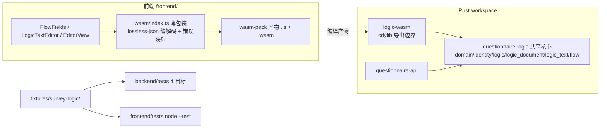

# WASM 统一前后端 DSL 解析 — 实施计划

> 状态：**已实施完成**（2026-10-12，分支 `wasm-dsl-unification`，HEAD `feb1230`）。Phase 0–5 全部落地，
> 验证记录见 `docs/requirements-analysis.md` §24；下文保留立项时的计划原文作为历史记录（含各阶段的原始
> 验证口径与预期），不再逐条改写，只在阶段标题后标注完成状态。文中的旧命令与旧路径（如
> `wasm-pack build logic-wasm --target bundler --release`、`backend/src/logic*.rs`）是立项时的快照，
> 不要照抄：当前结构、命令与用法以 §24、`README.md`、`docs/backend-guide.md`、`docs/frontend-guide.md`
> 为准。可行性报告 `docs/wasm-dsl-feasibility-report.md`
> 已核实条件成熟并采纳本计划作为执行清单；行数、版本等事实基线以报告核实结果为准。曾在本
> 分支开工（crate 拆分进行到一半）后按决定回滚，回滚点：`dsl-survey-editor` 分支 `48eab76`。

## 1. 现状与问题

同一套 DSL 语义存在两份手写实现，靠 `fixtures/survey-logic/` 共享样例维持一致：

| 语义层 | Rust（后端） | TS（前端镜像） |
|---|---|---|
| 表达式编译/三值求值 | `backend/src/logic.rs`（828 行） | `frontend/src/logic.ts`（511 行） |
| 文档规则/变量拓扑 | `backend/src/logic_document.rs`（449 行） | `frontend/src/document-logic.ts`（393 行） |
| 文本 DSL 解析 | `backend/src/logic_text.rs`（587 行，pest） | `frontend/src/logic-text.ts`（469 行，手写递归下降） |
| 流程编译/会话 | `backend/src/flow.rs`（963 行） | `frontend/src/flow-compiler.ts`（272 行）+ `flow.ts`（361 行） |
| 身份/数值契约 | `backend/src/identity.rs`（24 行）+ `domain.rs` 部分 | `frontend/src/value-contract.ts` + `numbers.ts`（lossless-json） |

前端核心引擎 5 文件共 2 006 行镜像实现，且已有一处单边漂移：`formatLogicText`（文本格式化，
`frontend/src/logic-text.ts:383`）只存在于 TS，Rust 无对应实现。每次语义变更须双端同步修改并跑
双份回归；当前两端错误码集合仍一致（`LogicErrorCode` 18 个），漂移尚未扩散到语义层。

消费点（改造后保持不变，只换引擎）：

- 填写页 `/s/:id`：`FlowFields.vue` → `FlowInputs` → `FlowSession`（每次 change/next/previous 都走 DSL 引擎）。
- 编辑器：`EditorView.save` 用 `compileDocumentLogic` 做保存预检；`LogicTextEditor` 用
  `parseLogicText`/`formatLogicText`（300ms 防抖）；`editor-logic.ts`/`condition-builder.ts`
  消费 `LogicError`/AST。

## 2. 目标架构

关键决策：

1. **必须先抽共享 crate**。DSL 核心六文件（`domain.rs`、`identity.rs`、`logic.rs`、
   `logic_document.rs`、`logic_text.rs` + `logic_text.pest`、`flow.rs`）已是纯逻辑
   （无 DB/HTTP/时间依赖；`domain.rs::renew_ids` 与 `flow.rs` 虚拟节点 ID 是仅有的
   `Uuid::new_v4` 调用点），但与 axum/sea-orm 同住在 `questionnaire-api`，无法直接编译到
   wasm。新增 workspace 成员 `logic-core/`（crate 名 `questionnaire-logic`），后端与 wasm
   crate 都依赖它。
2. **wasm 边界用 JSON 字符串，不用 serde-wasm-bindgen**。输入输出本来就是 JSON DTO；字符串
   边界天然保住数字精度（Rust 端 `arbitrary_precision` + JS 端 lossless-json，两端现有约定
   不动），并让错误结构（`code/path/question_id/line/column`）无损穿透。每次调用多一次 JSON
   往返，编辑器有 300ms 防抖、填写页会话有状态类，开销可忽略。
3. **`FlowSession` 用 wasm-bindgen 导出类**（`new(document_json)` / `dispatch(event_json)` /
   `snapshot()`），状态留在 wasm 线性内存，避免每次改答重编译文档；`parse_logic_text` /
   `format_logic_text` / `compile_document_logic` 为无状态函数。
4. **格式化器移到 Rust**（`format_logic_text`），消除当前唯一的单边实现。

### 后端接线的最小改动形态（回滚前验证过的做法）

- 根 `Cargo.toml`：`members = ["backend", "logic-core", "logic-wasm"]`。
- `backend/src/lib.rs`：删去 `mod domain; mod flow; mod identity; mod logic; mod logic_document;
  mod logic_text;`，代之以 `pub use questionnaire_logic as domain;` —— `questionnaire_api::domain::*`
  路径不变，业务代码与 `backend/tests` 四个测试目标的 `use questionnaire_api::domain::{…}` 零改动。
- `backend/Cargo.toml` 增加 `questionnaire-logic = { path = "../logic-core" }`；随后
  `thiserror` / `utoipa` / `uuid` / `pest` / `pest_derive` / `serde` / `serde_json` 是否仍被
  后端直接使用，逐项核对后再决定是否移除（本次只验证到编译接线，未做裁剪）。

### 实施时已知的坑（本次踩过）

- 移动文件用 `git mv` 保历史；六个文件内部互相只引用兄弟模块（`crate::flow`、`crate::logic`
  等），在新 crate 根下路径不变，无需改写。
- 后端业务代码对核心 crate 的使用全部走 `domain::` 再导出路径（审计结果：
  `Document`、`Answer`、`ValidationError`、`MAX_SUBMISSION_BYTES`、`FlowEvaluator`、
  `renew_ids`、`Question`、`QuestionKind`、`Choice`、`AnswerState`），无 `pub(crate)` 越界引用，
  可见性无需从 `pub(crate)` 提升为 `pub`。
- 编辑 `lib.rs` 模块列表时容易误删 `mod entities;`（本次踩过），回改时按字母序核对。

## 3. 阶段计划

### Phase 0 — 工具链（已完成，重启时跳过） ✅

- `rustup target add wasm32-unknown-unknown`：2026-10-11 已装（本机原仅 x86_64-msvc），回滚不
  影响 rustup 组件；可行性报告已复核 `rustup target list --installed` 含该 target。
- `cargo install wasm-pack --locked`：2026-10-11 已装 v0.15.0 到 `E:\.cargo\bin`；可行性报告
  已复核 `wasm-pack --version`。
- 验证：`cargo build -p questionnaire-api` 不受影响——随 Phase 1 接线一并执行。

### Phase 1 — 抽出 `questionnaire-logic` crate（1–2 天） ✅

- 新成员 `logic-core/`：移入上列六文件 + `logic_text.pest`。依赖裁剪为：`serde`、
  `serde_json(arbitrary_precision)`、`pest`/`pest_derive`、`uuid`、`thiserror`、`utoipa`
  （`Document`/`FlowDefinition` 等 derive `ToSchema`）。
- `utoipa` 仅以 `ToSchema` derive 出现：派生产物为纯数据结构，wasm32 编译预期可行，由本阶段
  纯度闸门兜底验证（与报告 §3 同一判断）。
- 后端按上节「最小改动形态」接线。
- **验证**：`cargo test --locked --workspace`（domain/logic/flow/logic_text 四目标全绿）；
  `cargo build -p questionnaire-logic --target wasm32-unknown-unknown` 作为纯度闸门（这一步会
  暴露 getrandom 问题，提前处理）。
- getrandom 对策：`logic-wasm` 直接声明 `getrandom = { version = "0.4", features = ["wasm_js"] }`
  （feature 合并生效），`.cargo/config.toml` 增加
  `[target.wasm32-unknown-unknown] rustflags = ["--cfg", "getrandom_backend=\"wasm_js\""]`。
  若仍有摩擦，备选是把 `flow.rs` 虚拟节点 ID 改为确定性生成（仅运行态，注释已声明不入指纹），
  代价是语义微调，不作首选。
- 本机 lock 图已核实（2026-10-11，与报告 §4 同源）：`uuid 1.27.0` 依赖块含 `getrandom 0.4.3`、
  `js-sys`、`wasm-bindgen`——wasm 兼容路径已在依赖图中，`wasm_js` feature 路线可用。

### Phase 2 — 移植 `formatLogicText` 到 Rust（1 天） ✅

- 按 `frontend/src/logic-text.ts` 的别名生成与输出格式逐条移植为
  `format_logic_text(&DocumentLogic, &[Question]) -> String`。
- `fixtures/survey-logic/texts.json` 增加人工期望的 `format_cases`（输入 logic JSON + 期望文本），
  Rust `backend/tests/logic_text.rs` 与前端测试同读；附加往返断言
  `parse(format(parse(x))) ≡ parse(x)`。
- **验证**：双端对 `format_cases` 逐字节相等；现有 texts.json 用例不回归。

### Phase 3 — `logic-wasm` crate 与构建（1–2 天） ✅

- 新成员 `logic-wasm/`，`crate-type = ["cdylib"]`，依赖 `questionnaire-logic` + `wasm-bindgen`。
  导出（全部同步函数，信封格式 `{"ok":…} | {"error":…}`）：
  - `parse_logic_text(source, questions_json)`
  - `format_logic_text(logic_json, questions_json)`
  - `compile_document_logic(logic_json, questions_json)`（诊断预检；错误信封含
    `path/question_id`）
  - `compile_expression(raw, questions_json)`（类型 + 依赖，供 ExpressionEditor）
  - `renew_document_ids(document_json)`（编辑器复制问卷/规则时的 ID 重写，替代 TS 侧
    `rewrite` 逻辑）
  - `class FlowSession { new(document_json), dispatch(event_json), snapshot() }`
- 构建：`wasm-pack build logic-wasm --target bundler --release`，产物（`.js` 胶水 + `.wasm`）
  提交到 `frontend/src/wasm/pkg/`；仓库无 CI，前端开发者不装 Rust 工具链，故产物入库，重建
  命令写入文档并在 `frontend/package.json` 加一个可选 `wasm:build` 脚本。根 `Cargo.lock`
  随之更新（保持权威）。
- **验证**：Node 冒烟脚本 `initSync(readFileSync(...))` 后跑一个 fixtures 文本用例；报告
  `.wasm` 体积（预期 300–600 KB，wasm-pack 默认过 wasm-opt）与典型解析耗时（预期 <1ms）。

### Phase 4 — 前端接入与镜像删除（2 天） ✅

- 新增 `frontend/src/wasm/index.ts`：动态 import + 初始化（Vite 环境走 bundler 胶水默认导出，
  node 测试走 `initSync`；已核实 Vite 8.3.0 与 Node 22 原生跑 .ts）；提供与现有签名兼容的
  `parseLogicText` / `formatLogicText` / `compileDocumentLogic` / `compileExpression` /
  `FlowSession`；信封错误映射回既有 `LogicError` / `LogicTextError` 类（这两个错误类保留，
  是 UI 契约）；入参出参用 `json.ts` 的 lossless 编解码保数字原文。类型定义（`DocumentLogic`
  等 DTO interface）随包装手写保留。
- 换引擎：`flow-inputs.ts` 内部改持 wasm `FlowSession`；`EditorView.save`、`LogicTextEditor`、
  `documents.ts` 的复制/重写改调包装。
- 删除：`logic.ts` 编译求值内部、`logic-text.ts`、`document-logic.ts` 编译部分、`flow.ts`、
  `flow-compiler.ts`（约 −1 900 行）。保留：`logic-text-tools.ts`（绑定速览/签名/偏移，纯 UI
  文本工具）、`condition-builder.ts`、`editor-logic.ts`、`answers.ts` 及其依赖的
  `numbers.ts`/`value-contract.ts`/`json.ts`（无 logic 问卷的本地校验路径）。
- 测试：`frontend/tests/*.test.mjs` 改从包装导入，断言不动 —— fixtures 仍是唯一语义契约，
  只是从「双实现对照」变为「单实现双端回归」。
- **验证**：`pnpm run test:regression` 全绿；`pnpm run build` 通过；起真实后端手动冒烟
  `/s/:id`（含 logic 问卷的改答、分支、提交）与编辑器文本模式（防抖诊断、格式化、往返、
  保存预检）。

### Phase 5 — 文档与规范同步（半天） ✅

- `AGENTS.md`：workspace 成员、模块表、wasm 构建命令、前端约定（产物入库与重建）、
  「workspace 仅 `backend` 一个成员」的过时表述更新。
- `docs/backend-guide.md`（crate 拆分）、`docs/frontend-guide.md`（包装 API、重建流程）、
  `README.md` §7（检查选择表加 wasm 重建行）、`docs/requirements-analysis.md` 追加本阶段
  验证记录。

## 4. 风险与对策

| 风险 | 对策 |
|---|---|
| getrandom 在 wasm32 编译失败 | Phase 1 的目标编译闸门提前暴露；首选 `wasm_js` backend，备选确定性虚拟 ID |
| 格式化器移植输出不一致 | `format_cases` 人工样例逐字节比对 + 往返等价断言，双端同读 |
| 数字精度经 JS 边界丢失 | 全程 JSON 字符串 + 双端既有 lossless/arbitrary_precision 约定；fixtures 含数值边界用例兜底 |
| node --test 加载 wasm | bundler 产物的 `initSync` + `readFileSync`，包装内按环境分支 |
| 主线程卡顿 | 导出全同步且微秒级；编辑器已有防抖；若实测超预算，`FlowSession` 可整体挪入 Worker（包装接口不变，contingency） |
| `.wasm` 体积 | release + wasm-opt；超预期再开 `opt-level = "z"` 评估（共享 crate 不动，仅 wasm 构建配置） |

## 5. 验收标准

1. `cargo test --locked --workspace`、`cargo clippy --locked --workspace --all-targets -- -D warnings`
   全绿，后端行为零变化。
2. `pnpm run test:regression`、`pnpm run build` 全绿；`frontend/src` 中不再存在表达式/文档/文本/流程
   的 TS 编译求值实现（仅剩包装、错误类与 UI 工具）。
3. `format_logic_text` 只有 Rust 一份实现，`fixtures/survey-logic/` 全部样例双端一致。
4. 真实服务路径冒烟通过：含 logic 问卷的填写（改答清理、分支、提交）与编辑器（文本模式
   诊断/格式化、保存预检、复制重写）。
5. 重建命令一条 documented：`wasm-pack build logic-wasm --target bundler --release`，产物入库。

总工期约 6–8 个工作日（Phase 0 已完成，实际重启工作量覆盖 Phase 1–5）；最大不确定性在
Phase 1 的 wasm 纯度闸门与 Phase 2 的格式化器逐字节对齐，两者都安排在删除 TS 实现之前完成
验证。
